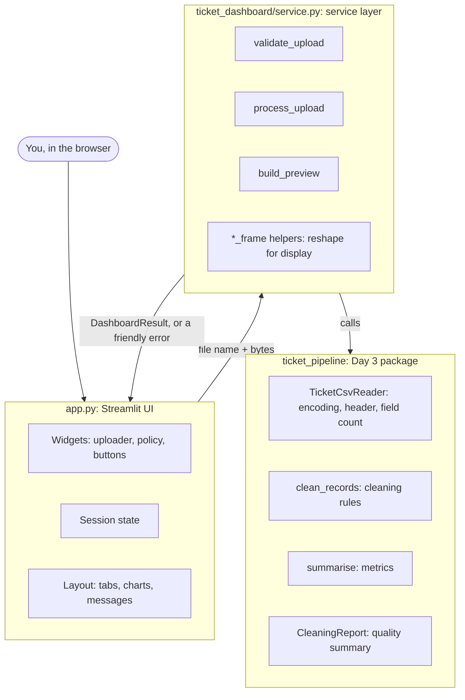
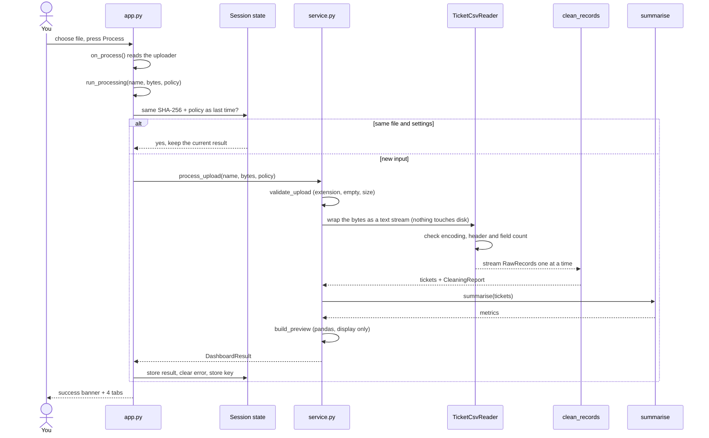
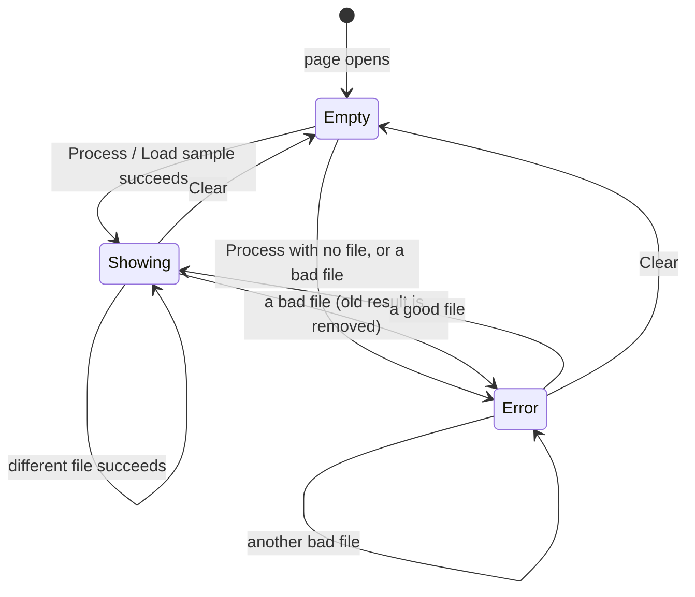
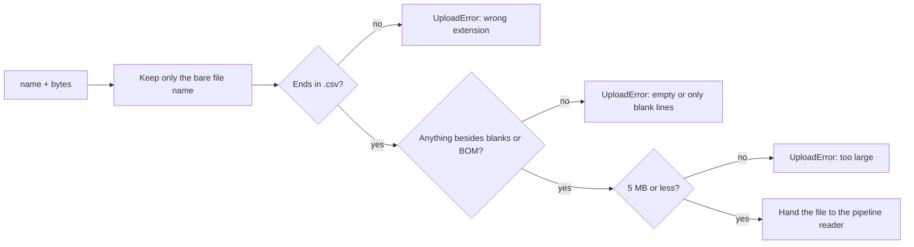
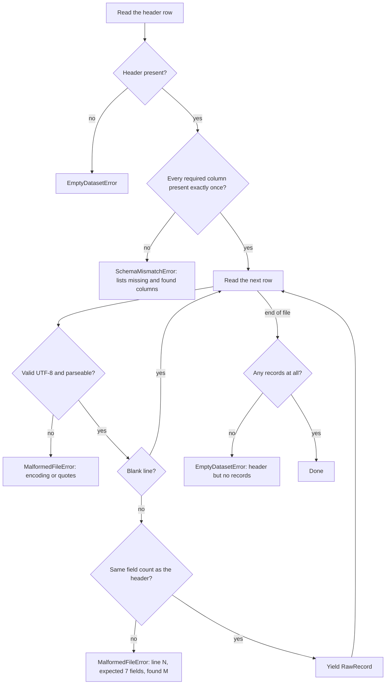
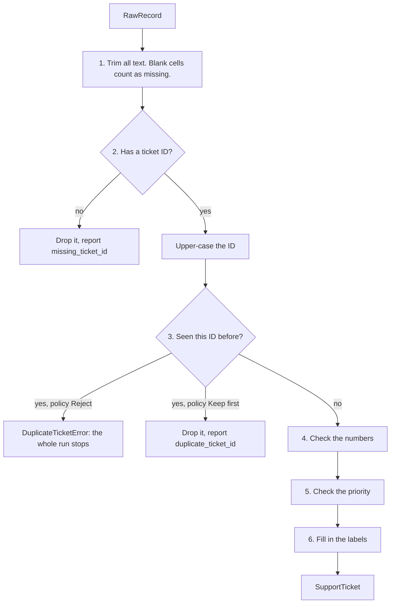
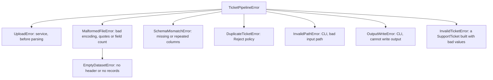
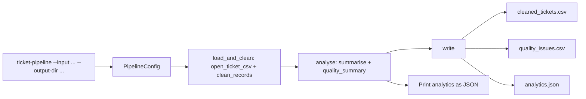

# Support Ticket Dashboard

*Day 4 of training: Streamlit and application basics*

Support teams export their tickets as CSV files, and those files are rarely tidy.
Some IDs are missing, some appear twice, ratings say `abc`, and now and then a stray
comma pushes a row out of line.

This project is a small internal web app for that problem. You upload the export
and the app tells you, in plain words, what the file contains, what was wrong
with it, what it fixed, and what the clean data says. If the file can't be used
at all, it explains why and what to do about it. It never shows you a wall of
Python errors.

Under the hood the app reuses the cleaning pipeline from Day 3. The dashboard is
a thin, friendly layer on top of it and adds no data rules of its own.

---

## Contents

1. [What you get](#1-what-you-get)
2. [Quick start](#2-quick-start)
3. [The big picture](#3-the-big-picture)
4. [Component flows](#4-component-flows)
   - [4.1 Upload to dashboard](#41-upload-to-dashboard-the-main-flow)
   - [4.2 Buttons and session state](#42-buttons-and-session-state)
   - [4.3 Upload checks](#43-upload-checks-service-layer)
   - [4.4 Reading the CSV](#44-reading-the-csv-loader)
   - [4.5 Cleaning each record](#45-cleaning-each-record)
   - [4.6 Analytics](#46-analytics)
   - [4.7 Preview](#47-preview)
   - [4.8 How errors travel](#48-how-errors-travel)
   - [4.9 Command-line pipeline](#49-command-line-pipeline-day-3)
   - [4.10 Logging](#410-logging)
5. [Using the dashboard](#5-using-the-dashboard)
6. [What you see for each kind of file](#6-what-you-see-for-each-kind-of-file)
7. [Testing](#7-testing)
8. [Code quality checks](#8-code-quality-checks)
9. [Secrets and local paths](#9-secrets-and-local-paths)
10. [Project layout](#10-project-layout)
11. [Assumptions](#11-assumptions)
12. [Known limitations](#12-known-limitations)
13. [More documents](#13-more-documents)

---

## 1. What you get

Upload a ticket CSV (or press **Load sample data**) and the app gives you four tabs:

| Tab | What it shows |
|---|---|
| **Preview** | The raw file as it arrived: number of rows and columns, each column's type and how many cells are filled, and the first 10 rows |
| **Analytics** | Clean tickets, unresolved tickets and average rating; tickets per priority; average resolution time and resolution rate per category |
| **Data quality** | What was wrong: invalid records, rows dropped for a missing ID, duplicates removed, and missing or invalid values for each column |
| **Cleaned data** | The cleaned table, plus a **Download cleaned CSV** button |

### Day 4 goals and where each one is met

| Goal | Where it is met |
|---|---|
| App starts using documented instructions | [Quick start](#2-quick-start); proof in `results/app_startup.log` |
| UI calls reusable business logic | `app.py` → `ticket_dashboard.service` → `ticket_pipeline` ([big picture](#3-the-big-picture)) |
| Invalid uploads never crash without an explanation | [Section 6](#6-what-you-see-for-each-kind-of-file); 9 bad files tested through the real upload widget |
| Analytics agree with the underlying data | 3 independent agreement tests ([section 7](#7-testing)) |
| No secrets or local-only paths committed | [Section 9](#9-secrets-and-local-paths) |

---

## 2. Quick start

You need **Python 3.10 or newer**. It was built and tested on Python 3.15.2 under Windows 11.

**1. Set up** (from the folder that contains this README)

Windows (PowerShell):
```powershell
python -m venv .venv
.venv\Scripts\Activate.ps1
python -m pip install --upgrade pip
pip install -e ".[dev]"
```

macOS / Linux:
```bash
python3 -m venv .venv
source .venv/bin/activate
python -m pip install --upgrade pip
pip install -e ".[dev]"
```

`-e` installs the project in editable mode, so both packages can be imported
from anywhere. `[dev]` adds the tools for testing and checks (pytest, ruff, mypy).
If you only want to run the app, `pip install -e .` is enough.

**2. Run it**
```bash
streamlit run app.py
```

Open <http://localhost:8501> and press **Load sample data** for a full dashboard
straight away. To stop the server, press `Ctrl+C`.

The settings are in `.streamlit/config.toml`. Uploads are capped at 5 MB, the
server doesn't open a browser by itself, and usage statistics are switched off.

**3. Prefer the terminal?** The Day 3 command-line tool still works:
```bash
ticket-pipeline --input data/tickets.csv --output-dir output
```

---

## 3. The big picture

The project has three layers. Each one has a single job and stays out of the others' business.



| Layer | Its job | What it never does |
|---|---|---|
| `app.py` | Draw widgets, remember state, lay out tabs and charts, show messages | Parse CSV, clean values or work out metrics |
| `ticket_dashboard.service` | Check the upload, pass the bytes to the pipeline, turn results into tables | Invent cleaning rules or metrics; import Streamlit |
| `ticket_pipeline` | Read, validate, clean and analyse | Know that a UI exists |

Why split it like this? Because each part can then be tested on its own. The
service has no Streamlit in it, so plain pytest can test it. The pipeline is the
same code the command-line tool uses, so the app and the CLI can never disagree
about the numbers.

The design decisions and trade-offs are written up in [docs/DESIGN.md](docs/DESIGN.md).

---

## 4. Component flows

This section follows a file from the moment you pick it to the moment the
dashboard appears, and then looks at each piece on its own.

### 4.1 Upload to dashboard (the main flow)



The key trick is in the middle. The Day 3 reader was written to read from any
text stream, not just a file on disk. The service wraps the uploaded bytes like this:

```python
io.TextIOWrapper(io.BytesIO(data), encoding="utf-8-sig", newline="")
```

That means an upload goes through exactly the same encoding, header, field-count
and empty-file checks as a file read by the CLI, and nothing is ever written to disk.

### 4.2 Buttons and session state

Streamlit reruns the whole script every time you click something. Session state
is how the app remembers what it is currently showing between reruns.

| Key | What it holds |
|---|---|
| `result` | The `DashboardResult` on screen, or `None` |
| `error` | The last error message you can fix, or `None`. It is never set at the same time as `result`, so you never see old analytics next to a new error. |
| `source_key` | SHA-256 of the processed bytes plus the duplicate policy. Pressing a button again with the same input doesn't reprocess the file. |
| `uploader_v` | Part of the uploader's widget key. **Clear** bumps it, which is the supported way to empty a `file_uploader`. |
| `policy` | The duplicate-ID policy chosen in the form |

All keys are set up in `init_state()` in `app.py`.



What each button does:

| Button | Callback | What happens |
|---|---|---|
| **Process** | `on_process()` | Takes the file from the uploader. If none is chosen, it shows "No file selected. Choose a CSV file, then press Process." Otherwise it calls `run_processing`. |
| **Load sample data** | `on_load_sample()` | Reads `data/tickets.csv` and calls `run_processing` with the policy currently selected |
| **Clear** | `on_clear()` | Resets `result`, `error` and `source_key`, then bumps `uploader_v` so the uploader is emptied |

The uploader, the policy dropdown and both submit buttons sit inside one
`st.form`. So changing the dropdown on its own does nothing until you press a
button, and **Load sample data** always uses the policy you have selected now.

### 4.3 Upload checks (service layer)

Before any parsing, `validate_upload` runs three cheap checks on the raw upload:



There's a story behind the extension check. The uploader originally had
`type=["csv"]`, but Streamlit enforces that by raising an exception the app
can't catch, so a `.txt` file produced a traceback. The fix was to remove `type=`
and let the service check the extension and explain the problem. The
reproduction is in `results/bug_uploader_type_filter.log`.

### 4.4 Reading the CSV (loader)

`TicketCsvReader` in `ticket_pipeline/processing/loader.py` reads the header as
soon as it is created, then hands out records one at a time. The whole file is
never held as a list of rows.



The encoding is `utf-8-sig`, so plain UTF-8 works and so do files Excel saved
with a byte-order mark. Extra columns are allowed and simply ignored.

### 4.5 Cleaning each record

`clean_records` in `ticket_pipeline/processing/cleaning.py` makes one pass over
the records. For each one it applies these rules in order:



| Field | Rule |
|---|---|
| `resolution_time_hours` | Must be a plain, finite decimal number of 0 or more. Anything else is cleared to empty and reported as invalid. An empty cell stays empty and isn't counted as invalid. |
| `customer_rating` | Must be a number between 1 and 5, otherwise the same as above. Text like `nan`, `inf`, `1_000` or `0x10` is rejected even though Python's `float()` would accept it. |
| `priority` | Case and spaces don't matter. Empty becomes `unknown`. An unrecognised value also becomes `unknown` and is reported. |
| `category`, `status` | Lower-cased. Empty becomes `unknown`. |
| `description` | Empty becomes `""`. It is free text from customers, so it is never logged. |

As it goes, cleaning keeps count of everything in a `CleaningReport`: source
rows, clean rows, dropped and duplicate rows, missing values before and after
cleaning, invalid numbers per column, and a list of every issue with its record
number. The Data quality tab is built from this report.

### 4.6 Analytics

`summarise` in `ticket_pipeline/analytics.py` turns the clean tickets into
metrics. These are pure functions: tickets go in, numbers come out, no files and
no side effects.

| Metric | How it is worked out |
|---|---|
| `ticket_count_by_priority` | Tickets counted per priority |
| `average_resolution_time_hours_by_category` | Mean time per category, using only tickets that have a valid time |
| `average_customer_rating` | Mean of the valid ratings, or `None` if there are none (shown as "n/a") |
| `unresolved_ticket_count` | Tickets whose status is not `resolved` or `closed` |
| `resolution_rate_by_category` | Share of each category that is resolved or closed, from 0 to 1 |

Averages and rates are rounded to 2 decimal places and results are sorted by key,
so every run gives the same output. The service then merges in
`report.quality_summary()`. The `*_frame` helpers in `service.py` only reshape
these numbers into tables and charts. They never calculate anything new.

### 4.7 Preview

The Preview tab shows the raw file **before** any cleaning, so `build_preview`
reads the bytes a second time with pandas, for display only. A numeric column
holding a bad value such as `abc` shows up as `object` or `str`, and that is
actually handy for spotting problems at a glance.

The pipeline remains the source of truth. By the time the preview is built, the
reader has already rejected anything pandas would choke on. The preview's own
error branch is just a safety net.

### 4.8 How errors travel

Every problem you can fix yourself is a subclass of `TicketPipelineError`, and
each message names the file, explains what's wrong and suggests a fix.



There are exactly two places that catch errors:

- **The UI** (`run_processing` in `app.py`) catches `TicketPipelineError`, stores the message in `error` and clears `result`.
- **The CLI** (`cli.main`) catches the same base class, prints `error: ...` and exits with code 2.

Anything else is a real bug. It is deliberately **not** caught, so it shows up
loudly instead of being hidden. Messages only ever include the bare file name,
never a folder path from the server.

### 4.9 Command-line pipeline (Day 3)

The CLI runs the same stages, reading from disk and writing three files:



| Option | Default | Meaning |
|---|---|---|
| `--input` | `data/tickets.csv` | CSV file to read |
| `--output-dir` | `output` | Folder for the result files |
| `--duplicate-policy` | `keep_first` | `keep_first` keeps the first copy of an ID; `raise` stops the run |
| `--log-level` | `INFO` | `DEBUG`, `INFO`, `WARNING` or `ERROR` |

Exit codes: `0` for success, `2` when the input or output was rejected.

Writes are **atomic**. Each file is written to a `.tmp` file first and then
moved into place, so a failed write never leaves a half-written file behind. The
writer also refuses to overwrite the input file.

### 4.10 Logging

- Each pipeline stage is wrapped in the `@log_stage` decorator, which logs when
  the stage starts and finishes (with its duration in ms) or fails.
- Cleaning logs one summary line, one warning per issue type with its record
  numbers, and per-record detail only at `DEBUG` level.
- Log lines are `key=value` pairs, for example:
  `2026-11-04 10:15:02 INFO ticket_pipeline.pipeline stage_finished stage=clean duration_ms=3.1`
- Privacy comes first. The `description` field is masked as `[REDACTED]`, and
  ticket text never reaches the logs, only counts and IDs.
- In the dashboard the logs go to the terminal running Streamlit. `configure_logging`
  replaces its handler on every rerun, so lines are never duplicated.

---

## 5. Using the dashboard

1. In the sidebar, choose a CSV file and pick how to handle repeated ticket IDs:
   - **Keep first, report later copies** keeps the first one, drops the rest and lists them.
   - **Reject the file if any ticket ID repeats** stops at the first repeat.
2. Press **Process**, or press **Load sample data** to try the bundled file.
3. Look through the four tabs (see [section 1](#1-what-you-get)).
4. Press **Clear** to start over.

Your file needs these columns. Extra ones are fine and are ignored:

```
ticket_id, category, priority, description, resolution_time_hours, customer_rating, status
```

---

## 6. What you see for each kind of file

Each case below has a test file in `tests/fixtures/uploads/` and is tested
through the real upload widget in `tests/dashboard/test_app.py`.

| Upload | Raised by | What you see |
|---|---|---|
| `valid.csv` | — | Green "Processed valid.csv: 4 clean tickets", then the tabs |
| `empty.csv` (0 bytes) | `UploadError` | `Upload 'empty.csv' is empty (0 bytes). Export the data again and re-upload it.` |
| `blank_lines.csv` | `UploadError` | `... contains only blank lines. ...` |
| `wrong_ext.txt` | `UploadError` | `... has the extension '.txt' instead of '.csv'. Export the ticket data as CSV ...` |
| A file over 5 MB | `UploadError` | `... is N MB, above the 5 MB limit. Split the export into smaller files.` (Streamlit's own 5 MB limit usually stops it first.) |
| `header_only.csv` | `EmptyDatasetError` | `'header_only.csv': the file has a header row but no ticket records. ...` |
| `malformed.csv` | `MalformedFileError` | `'malformed.csv' line 3: expected 7 fields, found 8. Check that values containing commas are wrapped in double quotes.` |
| `bad_quotes.csv` | `MalformedFileError` | `'bad_quotes.csv' line 2: expected 7 fields, found 4. ...` |
| `bad_encoding.csv` (Latin-1) | `MalformedFileError` | `'bad_encoding.csv': the file is not valid UTF-8 text (...). Re-save the file with UTF-8 encoding.` |
| `wrong_columns.csv` | `SchemaMismatchError` | `... missing required column(s): ticket_id, ... Found columns: id, type, urgency, text. Fix the header row ...` |
| Sample file with **Reject** | `DuplicateTicketError` | `Ticket ID T-002 appears in record 2 and again in record 23. Remove or renumber the duplicate, or run with the keep_first duplicate policy.` |
| `no_valid_ids.csv` | — (a valid file) | Yellow warning: "No valid tickets remained after cleaning, so analytics are empty." |
| **Process** with no file | — | `No file selected. Choose a CSV file, then press Process.` |

Errors appear in a red box at the top of the page, and the old results disappear.

---

## 7. Testing

```bash
pytest                    # all 228 tests, in random order (pytest-randomly)
pytest tests/dashboard    # only the Day 4 tests (42)
pytest -m ui              # only the Streamlit UI tests (17)
pytest -m integration     # whole pipeline and CLI against real files (17)
pytest --cov              # with branch coverage
```

| Test file | Tests | What they prove |
|---|---|---|
| `tests/dashboard/test_service.py` | 25 | Valid uploads work (BOM, CRLF, zero valid tickets); every bad file raises a specific error that names the file and leaks no path; the size limit at and above the boundary; the Reject policy; **analytics agreement**; nothing is written to disk |
| `tests/dashboard/test_app.py` | 17 | The app starts in the empty state with no exception; each test file goes through the real `st.file_uploader` and shows results or an explanation, never a traceback; sample data; Process with no file; a rerun reuses state; an error replaces an old result; Clear resets |
| `tests/unit`, `tests/integration` | 186 | The Day 3 pipeline tests, copied unchanged and still passing |

The UI tests use Streamlit's `AppTest`, which runs `app.py` headlessly and clicks
the real widgets, so no browser is needed.

**How "analytics agree with the data" is proven.** There are three independent checks:

1. `test_analytics_match_the_day3_pipeline_on_the_same_file`: the dashboard's analytics equal `run_pipeline(...).analytics` for `data/tickets.csv`.
2. `test_priority_counts_match_an_independent_count_of_the_raw_file`: re-counts priorities straight from the raw CSV with Python's `csv` module, applying the rules by hand.
3. `test_display_tables_carry_the_same_numbers_as_the_analytics`: every table and chart shown in the UI carries the same numbers as the analytics. On top of that, the `test_load_sample_...` UI test checks the `st.metric` values actually drawn on screen.

### Latest results

Saved outputs are in `results/`. They were re-run and re-confirmed on 2026-11-16.

| Check | Result | File |
|---|---|---|
| pytest (fixed and random order) | **228 passed** | `results/test_results.txt` |
| Coverage | **99%** overall; `service.py` 97% | `results/coverage.txt` |
| ruff check and format | All checks passed | `results/ruff.txt` |
| mypy `--strict` | No issues in 33 files | `results/mypy.txt` |
| App start-up | `/_stcore/health` → `ok`; `GET /` → 200 | `results/app_startup.log` |
| Bug reproduction | The `type=["csv"]` crash, before and after the fix | `results/bug_uploader_type_filter.log` |

What coverage misses is small and explained:

- `service.py` lines 128–129 are the preview's safety-net error branch (see [4.7](#47-preview)).
- `ticket_pipeline/__main__.py` is the 3-line `python -m` entry point, checked by hand.

Manual browser checks are listed in [docs/UI_TEST_CHECKLIST.md](docs/UI_TEST_CHECKLIST.md).
Screenshot evidence goes in [docs/SCREENSHOTS.md](docs/SCREENSHOTS.md).

---

## 8. Code quality checks

```bash
ruff check .           # lint
ruff format --check .  # formatting
mypy                   # strict type checking over src/, tests/ and app.py
```

---

## 9. Secrets and local paths

- The app needs no secrets, API keys or passwords. `.streamlit/secrets.toml` and
  `.env` are in `.gitignore` anyway, in case one is ever added.
- Paths in code are relative to the file that uses them, for example
  `Path(__file__).parent / "data" / "tickets.csv"`.
- In the saved evidence in `results/`, machine-specific paths were replaced with
  `<project>` and `<python>`, and network and IP lines were removed from the start-up log.
- Before each commit the repository is searched for drive-letter paths, user
  folders and key-like strings (see `DAILY_REPORT.md`).

---

## 10. Project layout

```
day4_ticket_dashboard/
├── app.py                        Streamlit UI: widgets, state and layout only
├── pyproject.toml                dependencies + pytest, coverage, mypy and ruff settings
├── .streamlit/config.toml        5 MB upload limit, headless, no usage stats
├── data/tickets.csv              25-row sample dataset
├── src/
│   ├── ticket_dashboard/         Day 4 service layer
│   │   └── service.py            upload checks, process_upload, preview, display tables
│   └── ticket_pipeline/          Day 3 package (unchanged)
│       ├── config.py             required columns, numeric rules, duplicate policy
│       ├── models.py             SupportTicket, CleaningReport, Priority
│       ├── errors.py             TicketPipelineError and its subclasses
│       ├── processing/
│       │   ├── loader.py         safe, streaming CSV reader
│       │   ├── validation.py     pure checks: schema, numbers, priority
│       │   ├── cleaning.py       the cleaning rules
│       │   └── writers.py        atomic file output
│       ├── analytics.py          metrics
│       ├── pipeline.py           connects the stages for the CLI
│       ├── cli.py                command-line entry point
│       ├── decorators.py         @log_stage timing and failure logging
│       └── logging_config.py     key=value logging with redaction
├── tests/
│   ├── conftest.py               shared fixtures
│   ├── dashboard/                Day 4 tests: test_service.py, test_app.py
│   ├── fixtures/uploads/         good and bad upload files
│   ├── unit/                     Day 3 unit tests
│   └── integration/              Day 3 end-to-end and CLI tests
├── results/                      saved test, coverage, lint, type and start-up output
├── docs/
│   ├── DESIGN.md                 design decisions
│   ├── UI_TEST_CHECKLIST.md      manual UI checks
│   ├── SCREENSHOTS.md            screenshot evidence
│   └── screenshots/
├── DAILY_REPORT.md
└── VIVA_ANSWERS.md
```

---

## 11. Assumptions

- Uploads are UTF-8 CSV files, with or without the byte-order mark Excel adds.
- The cleaning rules are the Day 3 rules ([section 4.5](#45-cleaning-each-record)).
  The dashboard only adds upload-level checks: extension, size and empty file.
- A ticket counts as resolved only when its status is `resolved` or `closed`.
- The dashboard is internal, used by one person at a time on a trusted network,
  so it has no login.
- The preview shows the **raw** file, with types as pandas sees them.

---

## 12. Known limitations

- **One file at a time, held in memory.** The 5 MB limit keeps memory use small.
- **One malformed row rejects the whole file.** This is deliberate (from Day 3):
  a shifted column should never quietly produce wrong analytics.
- **The Reject policy only reports the first repeated ID**, not all of them.
- **The file is parsed twice**: once by the pipeline (the source of truth) and
  once by pandas for the preview. That's cheap at 5 MB, but it means the preview's
  types are pandas' view of the file, not the pipeline's.
- **No login and nothing saved.** Results live in your browser session and are
  gone when you close the tab.
- **Screenshots aren't automatic.** The UI behaviour is proven by the 17 `AppTest`
  tests. To capture screenshots, follow [docs/SCREENSHOTS.md](docs/SCREENSHOTS.md).

---

## 13. More documents

- [docs/DESIGN.md](docs/DESIGN.md): layer boundaries, design decisions and state design
- [docs/UI_TEST_CHECKLIST.md](docs/UI_TEST_CHECKLIST.md): manual UI test cases and their results
- [docs/SCREENSHOTS.md](docs/SCREENSHOTS.md): screenshot evidence and how to add it
- [DAILY_REPORT.md](DAILY_REPORT.md): the Day 4 daily report
- [VIVA_ANSWERS.md](VIVA_ANSWERS.md): answers to the technical viva questions
