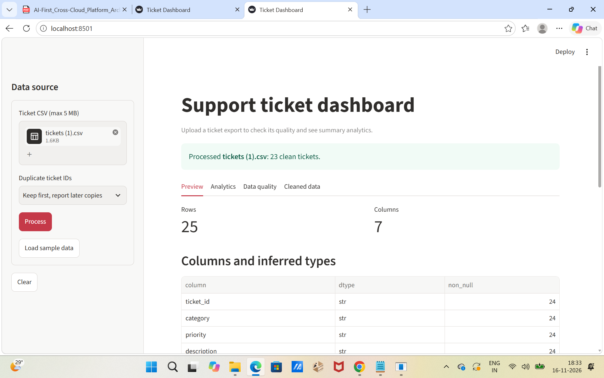
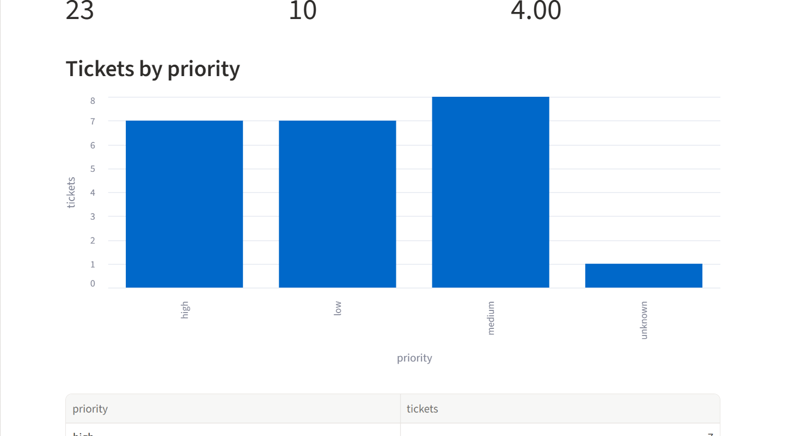
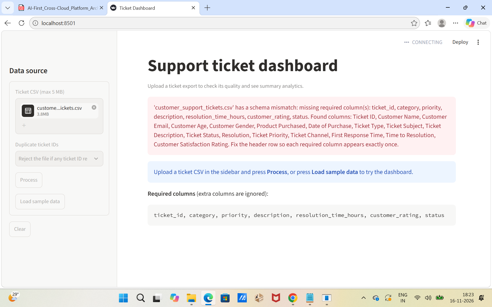
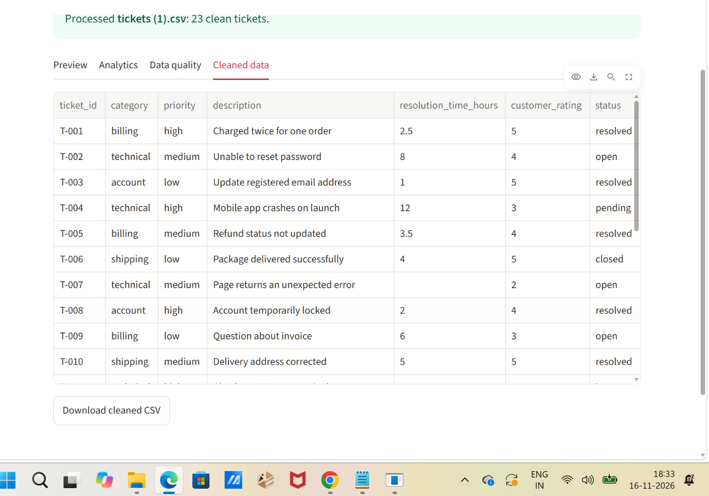

# Screenshot Evidence

Visual evidence for the manual checks in [`UI_TEST_CHECKLIST.md`](UI_TEST_CHECKLIST.md).
All image files live in [`docs/screenshots/`](screenshots/).

**Captured by:** _your name_  
**Date:** 2026-11-16  
**App version / commit:** `f007111` (Microsoft Edge, Windows 11, `streamlit run app.py`)

---

## How to add a screenshot

1. Start the app: `streamlit run app.py`, then open <http://localhost:8501>.
2. Do the step from the table below (for example, upload `tests/fixtures/uploads/malformed.csv` and press **Process**).
3. Take the screenshot:
   - **Windows:** press `Win + Shift + S`, drag over the browser window, then click the notification and press **Save** (or `Ctrl + S`).
   - **Whole page:** in Chrome/Edge press `F12` → `Ctrl + Shift + P` → type **Capture full size screenshot**.
4. Save it in `docs/screenshots/` with the **exact file name** from the table (lowercase, `.png`).
5. Open this file in a Markdown preview (VS Code: `Ctrl + Shift + V`). The image appears automatically, because each section below already links to its file.
6. Fill in the **Result** line under the image.

To add an extra screenshot, copy one section, give it the next number (`07_...png`), and change the image path:

```markdown
### 07. Short title
**Checklist row:** #
**Step:** what you did

**Result:** Pass / Fail. What you saw.
```

---

## Summary

| # | Screenshot | Checklist row | Result |
|---|---|---|---|
| 01 | `01_empty_state.png` | 2 | _Not captured yet_ |
| 02a | `02a_sample_preview.png` | 4–5 | **Pass** |
| 02 | `02_sample_analytics.png` | 5 | **Pass** |
| 03 | `03_data_quality.png` | 5 | **Pass** |
| 04 | `04_malformed_error.png` | 11 | _Not captured yet_ |
| 05 | `05_wrong_columns_error.png` | 14 | **Pass** |
| 06 | `06_cleaned_data.png` | 7 | **Pass** |

---

### 01. Empty state
**Checklist row:** 2  
**Step:** Open the page with no file uploaded.  
**Expected:** Title "Support ticket dashboard", blue info box asking for an upload, list of required columns, no error.


**Result:** _Not captured yet._

---

### 02a. Sample data uploaded: Preview tab
**Checklist row:** 4–5  
**Step:** Upload the sample file (`data/tickets.csv`, downloaded as `tickets (1).csv`) with **Keep first**, press **Process**.  
**Expected:** Green success message; Preview shows Rows 25, Columns 7, and the inferred column types.



**Result:** **Pass.** "Processed tickets (1).csv: 23 clean tickets." Rows 25, Columns 7; four tabs shown; no error.

---

### 02. Sample data analytics
**Checklist row:** 5  
**Step:** Same file, **Analytics** tab.  
**Expected:** Clean tickets 23; Unresolved 10; Average rating 4.00; tickets by priority.



**Result:** **Pass.** Metrics 23 / 10 / 4.00. Chart: high 7, low 7, medium 8, unknown 1 (total 23).

---

### 03. Data quality tab
**Checklist row:** 5  
**Step:** Same file, **Data quality** tab.  
**Expected:** Source rows 25, Invalid records 5, missing and invalid values per column.


**Result:** **Pass.** Source rows 25, Invalid records 5, Dropped (no ID) 1, Duplicates removed 1, duplicated ID `T-002`. Invalid values: 2 in `resolution_time_hours`, 1 in `customer_rating`.

---

### 04. Malformed CSV error
**Checklist row:** 11  
**Step:** Upload `tests/fixtures/uploads/malformed.csv` and press **Process**.  
**Expected:** Red message containing "line 3: expected 7 fields, found 8"; no traceback.


**Result:** _Not captured yet._

---

### 05. Wrong columns error
**Checklist row:** 14  
**Step:** Upload a real-world export with a different layout (`customer_support_tickets.csv`, 3.8 MB, columns such as `Ticket ID`, `Customer Name`, `Ticket Priority`) and press **Process**.  
**Expected:** Red message containing "missing required column(s)" and the columns that were found; no traceback.



**Result:** **Pass.** "has a schema mismatch: missing required column(s): ticket_id, category, priority, ..." followed by every column found in the file and how to fix the header. No traceback; the empty-state help stays visible below.

---

### 06. Cleaned data tab
**Checklist row:** 7  
**Step:** Sample file, **Cleaned data** tab.  
**Expected:** The cleaned table and a **Download cleaned CSV** button.



**Result:** **Pass.** Cleaned tickets shown (`T-007`'s invalid resolution time is now blank); **Download cleaned CSV** button present.
