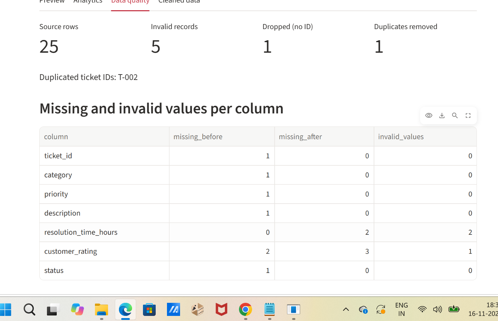

# Screenshot Evidence

Visual evidence for the manual checks in [`UI_TEST_CHECKLIST.md`](UI_TEST_CHECKLIST.md).
All image files live in [`docs/screenshots/`](screenshots/).

**Captured by:** _your name_  
**Date:** _YYYY-MM-DD_  
**App version / commit:** _e.g. `git rev-parse --short HEAD`_

---

## How to add a screenshot

1. Start the app: `streamlit run app.py`, then open <http://localhost:8501>.
2. Do the step from the table below (for example, upload `tests/fixtures/uploads/malformed.csv` and press **Process**).
3. Take the screenshot:
   - **Windows:** press `Win + Shift + S`, drag over the browser window, then click the notification and press **Save** (or `Ctrl + S`).
   - **Whole page:** in Chrome/Edge press `F12` → `Ctrl + Shift + P` → type **Capture full size screenshot**.
4. Save it in `docs/screenshots/` with the **exact file name** from the table (lowercase, `.png`).
5. Open this file in a Markdown preview (VS Code: `Ctrl + Shift + V`). The image appears automatically, because each section below already links to its file.
6. Fill in the **Result** line under the image.

To add an extra screenshot, copy one section, give it the next number (`06_...png`), and change the image path:

```markdown
### 06. Short title
**Checklist row:** #
**Step:** what you did

**Result:** Pass / Fail. What you saw.
```

---

## Summary

| # | Screenshot | Checklist row | Result |
|---|---|---|---|
| 01 | `01_empty_state.png` | 2 | _Pass / Fail_ |
| 02 | `02_sample_analytics.png` | 5 | _Pass / Fail_ |
| 03 | `03_data_quality.png` | 5 | _Pass / Fail_ |
| 04 | `04_malformed_error.png` | 11 | _Pass / Fail_ |
| 05 | `05_wrong_columns_error.png` | 14 | _Pass / Fail_ |

---

### 01. Empty state
**Checklist row:** 2  
**Step:** Open the page with no file uploaded.  
**Expected:** Title "Support ticket dashboard", blue info box asking for an upload, list of required columns, no error.


**Result:** _Pass / Fail. Notes._

---

### 02. Sample data analytics
**Checklist row:** 5  
**Step:** Press **Load sample data**.  
**Expected:** Preview 25 × 7; Clean tickets 23; Unresolved 10; Average rating 4.00; Invalid records 5.


**Result:** _Pass / Fail. Notes._

---

### 03. Data quality tab
**Checklist row:** 5  
**Step:** After loading the sample, open the **Data quality** tab.  
**Expected:** The 5 invalid records are listed with their reasons.



**Result:** _Pass / Fail. Notes._

---

### 04. Malformed CSV error
**Checklist row:** 11  
**Step:** Upload `tests/fixtures/uploads/malformed.csv` and press **Process**.  
**Expected:** Red message containing "line 3: expected 7 fields, found 8"; no traceback.


**Result:** _Pass / Fail. Notes._

---

### 05. Wrong columns error
**Checklist row:** 14  
**Step:** Upload `tests/fixtures/uploads/wrong_columns.csv` and press **Process**.  
**Expected:** Red message containing "missing required column(s)" and the columns that were found; no traceback.


**Result:** _Pass / Fail. Notes._
